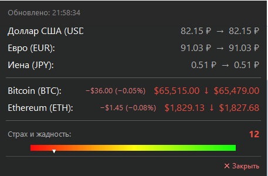

# 💱 Currency Widget

Компактный виджет для рабочего стола Windows 10, который показывает курсы
валют и криптовалют в реальном времени.



## ✨ Возможности

- **Фиат:** USD, EUR, JPY к RUB (данные ЦБ РФ)
- **Крипта:** BTC, ETH в USD (данные CoinGecko)
- **Индикация движения:** ↑ рост (зелёный), ↓ падение (красный), → без изменений
- **Дельта:** разница между старой и новой ценой в рублях/долларах и процентах
- **Автообновление** каждые 60 секунд
- **Всегда поверх окон**, перетаскивается мышью, закрывается по `Esc`
- **Логирование** в `logs/widget.log` с ротацией (1 МБ × 3 бэкапа)
- **Безопасность:** только HTTPS, проверка редиректов, таймауты, валидация JSON

## 📋 Требования

- Windows 10 / 11
- Python 3.9+
- Интернет

## 🚀 Установка

### Вариант 1: Запуск из исходников

```bash
git clone https://github.com/<Le7nik>/currency-widget.git
cd currency-widget

# Создать виртуальное окружение
python -m venv .venv
.venv\Scripts\activate

# Установить зависимости
pip install -r requirements.txt

# Запустить
python Widget.py

### Вариант 2: Запуск *.exe
Скачайте файл `CurrencyWidget.exe`.
Запустите его (файл создаст папку `logs` рядом с собой).  
